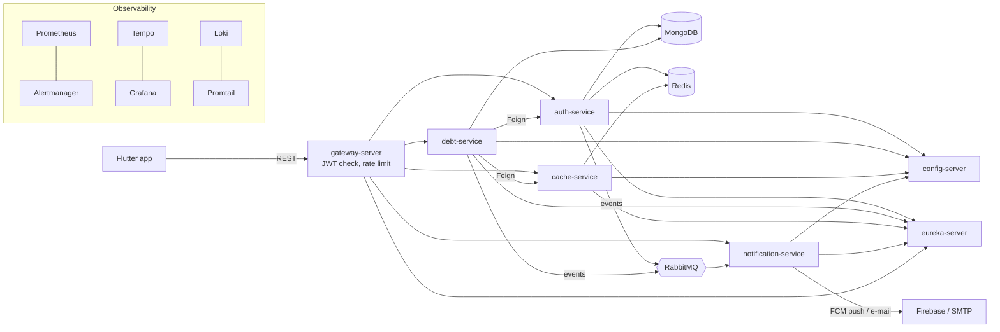

# Kamci

Kamci is a personal and household debt tracker: one-off and recurring debts, instalments, partial payments,
reminders, shared categories, multi-currency support and monthly charts. The backend is a set of Spring Boot
microservices behind a Spring Cloud Gateway, and the client is a Flutter app. This monorepo holds the services,
the platform layer (gateway, discovery, central config, observability), Kubernetes manifests and the mobile app.

## Architecture



## Tech stack

- **Backend:** Java 17, Spring Boot 4.0, Spring Cloud 2025.1 (Gateway, Config, Eureka, OpenFeign), MongoDB, RabbitMQ, Redis
- **Mobile:** Flutter, Riverpod, Dio, go_router, freezed
- **Observability:** Prometheus, Alertmanager, Grafana, Tempo, Loki, Promtail
- **Delivery:** Docker Compose, Kubernetes (k3s) manifests, GitHub Actions

## Quick start

Needs Docker only.

```bash
cp .env.example .env            # optional overrides, compose has local defaults
docker compose up -d --wait
bash scripts/smoke.sh           # register -> login -> category -> debt -> pay -> mail
```

Add the observability stack with `docker compose --profile observability up -d --wait`.

| Port | What |
|---|---|
| 8080 | API gateway, the only entry point for API clients |
| 8888 | config-server |
| 8761 | Eureka dashboard |
| 8025 | Mailpit (local mail inbox) |
| 15672 | RabbitMQ management UI |
| 9090 / 9093 | Prometheus / Alertmanager (observability profile) |
| 3001 | Grafana (observability profile) |
| 3200 / 3100 | Tempo / Loki (observability profile) |

## Screenshots / demo

Kamci was not released commercially: the app is not in any store and there is no hosted instance, so there is no
live demo to link and this README has no screenshots or GIFs. Everything runs locally instead. `docker compose up -d --wait`
starts the whole backend, and the Flutter app runs against the local gateway (see
[`mobile/README.md`](mobile/README.md#running-it)). The tests and CI workflows below are the evidence that it works;
`scripts/smoke.sh` walks register, login, category, debt, payment and mail through the real compose stack.

## Repository layout

| Folder | Contents |
|---|---|
| [`backend/`](backend/README.md) | auth, debt, notification and cache services plus a shared module |
| [`infra/`](infra/README.md) | gateway-server, eureka-server, config-server, observability configs |
| [`config/`](config/README.md) | central Spring Cloud Config files served by config-server |
| [`k8s/`](k8s/README.md) | Kubernetes manifests, secret templates, apply script |
| [`mobile/`](mobile/README.md) | Flutter app |
| `scripts/` | end-to-end smoke test |
| [`docs/`](docs/ai-workflow.md) | how this project was built with AI agents |

## Tests and CI

| Area | Command | Workflow |
|---|---|---|
| backend | `mvn verify` in `backend/` | [`backend.yml`](.github/workflows/backend.yml) |
| infra | `mvn verify` in `infra/` | [`infra.yml`](.github/workflows/infra.yml) |
| mobile | `flutter analyze`, `flutter test` | [`mobile.yml`](.github/workflows/mobile.yml) |
| k8s | envsubst + kubeconform | [`k8s.yml`](.github/workflows/k8s.yml) |
| end to end | compose up, `scripts/smoke.sh` | [`compose-smoke.yml`](.github/workflows/compose-smoke.yml) |
| secrets | gitleaks | [`secrets-scan.yml`](.github/workflows/secrets-scan.yml) |

## Security notes

- JWT (HS256) validation, rate limiting and header sanitising happen in the gateway. Client-supplied
  `X-Forwarded-*` headers are dropped unless the peer is a trusted proxy, and identity headers are set only from the
  verified token.
- Paths with an `internal` segment are answered with 404 at the gateway, so service-to-service endpoints are not
  reachable from outside.
- Secrets come from environment variables or sealed secrets; the repository only has placeholders and templates.
  Every push is scanned with gitleaks, see [`.gitleaks.toml`](.gitleaks.toml) and [`SECURITY.md`](SECURITY.md).

## License

[PolyForm Noncommercial License 1.0.0](LICENSE).
